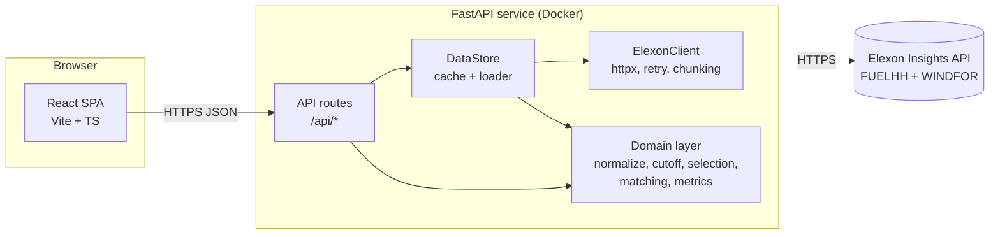
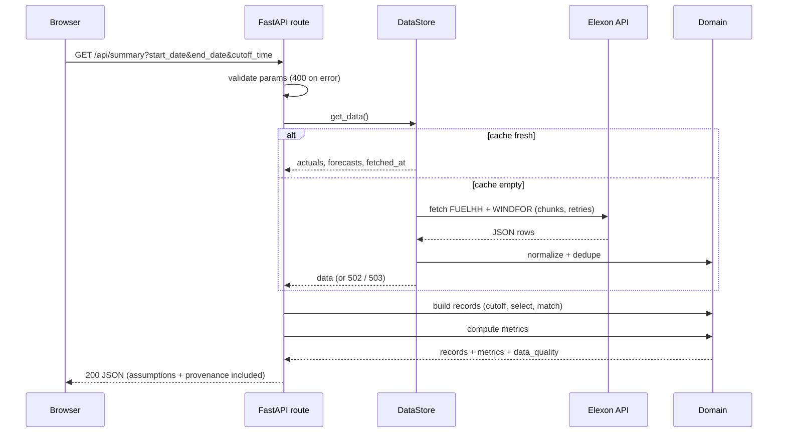
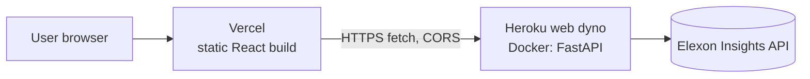

# ARCHITECTURE.md

> Goal: simple enough for one developer to build in 16 h and explain in 5 minutes.
> Related: [PRD](PRD.md) · [API_SPEC](API_SPEC.md) · [FORECAST_LOGIC](FORECAST_LOGIC.md) · [DEPLOYMENT](DEPLOYMENT.md)

## 1. System context
Users (procurement analysts) use a browser. The React app calls our FastAPI backend. The backend is the **only** component that talks to Elexon's public Insights API (no API key). There is **no database**.

## 2. Technology stack (final for this project)

| Layer | Choice | Reason / trade-off |
|---|---|---|
| Frontend | React 18 + Vite + TypeScript | Required React; fast builds |
| Charts | **Recharts** | Quick to build; enough for ≤ 744 points; has `Brush` for zoom. Trade-off: heavier than uPlot, less performant than ECharts for very large data (not our case) |
| Server state (frontend) | `@tanstack/react-query` | Caching, loading/error states, request de-dup. Justified dependency; saves hand-written fetch state code |
| Styling | Plain CSS + CSS variables (design tokens) | No Tailwind/UI kit: fewer dependencies, full control |
| Backend | Python 3.12 + FastAPI + Uvicorn | Required Python; typed, auto docs |
| HTTP client | `httpx` | Timeouts, retries via our wrapper |
| Models/config | `pydantic` v2 + `pydantic-settings` | Validated responses and env config |
| Time zones | stdlib `zoneinfo` + `tzdata` package | No extra date library |
| Maths | stdlib (`statistics`, `math`) + small percentile function | Avoid pandas/numpy for 744 rows (smaller image, simpler logic, easier to explain) |
| Tests | pytest, `respx` (mock httpx), Vitest, React Testing Library | As requested |
| Containers | Docker, Docker Compose | Required |
| Hosting | Frontend: Vercel · Backend: Heroku (Docker container) | See §9 |

**Why no database:** data is one month, read-only, re-fetchable, small (tens of thousands of rows). A cache is enough. A DB would add setup, migrations and hosting cost with no user benefit.

## 3. Component architecture



## 4. Responsibilities

| Frontend (`frontend/`) | Backend (`backend/`) |
|---|---|
| Layout, filters, charts, table, states, formatting numbers/dates | Elexon calls, validation, dedupe, forecast selection, matching, all metrics |
| Calls only `/api/*` (typed client in `src/api/`) | Exposes typed JSON; owns all business rules |
| **No** business logic, **no** metric math | **No** presentation logic |

Backend layers (dependencies point downward only):
1. `api/` — routes, request validation, response schemas, error mapping
2. `services/` — `elexon_client.py` (HTTP only), `data_store.py` (load, cache, single-flight lock)
3. `domain/` — **pure functions, no I/O**: `models.py`, `normalize.py`, `cutoff.py`, `selection.py`, `matching.py`, `metrics.py`

## 5. Data flow

```mermaid
flowchart TD
  A[Startup / first request] --> B[ElexonClient: FUELHH<br/>settlementDateFrom/To, weekly chunks]
  A --> C[ElexonClient: WINDFOR<br/>publishDateTimeFrom/To, weekly chunks]
  B --> D[normalize: keep fuelType=WIND,<br/>validate, dedupe -> ActualPoint]
  C --> E[normalize: validate, dedupe -> ForecastPoint]
  D --> F[(In-memory cache<br/>+ fetched_at)]
  E --> F
  F --> G[matching: build 744-period grid,<br/>cutoff -> selection -> join]
  G --> H[metrics: MAE, RMSE, bias, P90, coverage]
  G --> I[ComparisonRecord list]
  H --> J[/api/summary]
  I --> K[/api/series]
  I --> L[/api/records]
  J --> M[React dashboard]
  K --> M
  L --> M
```

Raw Elexon data is cached; **comparison records and metrics are computed per request** (cheap: 744 periods), because the cutoff and date range are request parameters.

## 6. Request lifecycle



## 7. Elexon integration strategy
- Single module `services/elexon_client.py`. Base URL from `ELEXON_BASE_URL`.
- FUELHH: `settlementDateFrom/To` in 7-day chunks; WINDFOR: `publishDateTimeFrom/To` in 7-day chunks (`ELEXON_CHUNK_DAYS`). Parameter names must be confirmed in Phase 1 ([DATA_DICTIONARY §3](DATA_DICTIONARY.md)).
- Accept both bare-array and `{"data": [...]}` responses.
- Timeout `ELEXON_TIMEOUT_SECONDS=30`; retry up to `ELEXON_MAX_RETRIES=3` on timeouts, connection errors, 429 and 5xx with exponential backoff (honour `Retry-After`). No retry on other 4xx.
- Sequential or max 2 concurrent requests (be polite to a public API).
- Chunk overlaps are harmless because of dedupe.
- No API key, nothing secret.

## 8. Error handling

| Failure | Behaviour |
|---|---|
| Elexon timeout/5xx after retries, **cache exists** | Serve stale cache, `provenance.stale=true`, UI shows warning |
| Same, **no cache** | `502 UPSTREAM_ERROR`; UI error state with retry button |
| First load in progress | `503 DATA_NOT_READY` + `Retry-After`; UI shows loading |
| Malformed row | Dropped and counted in `data_quality`; never crashes the load |
| Entire dataset empty | `200` with null metrics and warnings |
| Invalid request params | `400 INVALID_PARAMETER` |
| Unexpected exception | `500 INTERNAL_ERROR`, logged with request id, no stack trace to client |

## 9. Caching
- **Justified** because: Elexon calls take time, January 2026 is historical (stable), and a free Heroku-style dyno restarts.
- In-memory cache of normalised raw data, TTL `CACHE_TTL_SECONDS=86400`, single-flight `asyncio.Lock` so concurrent requests trigger one load.
- Preload in a background task at startup (`PRELOAD_ON_STARTUP=true`).
- P1: write a JSON snapshot to `CACHE_DIR` (default `/tmp/wind-cache`) to speed restarts. Snapshot = real fetched data with `fetched_at`; never committed to git.
- HTTP `Cache-Control` on read endpoints (see API_SPEC §8).
- No Redis, no CDN logic.

## 10. Deployment architecture



- Frontend: Vercel static deploy of `frontend/` (build `npm run build`, output `dist`, env `VITE_API_BASE_URL`).
- Backend: Heroku **container stack** using `heroku.yml` that builds `backend/Dockerfile`; binds `$PORT`.
- CORS: backend allows only origins in `CORS_ALLOWED_ORIGINS` (the Vercel URL + localhost).
- **Fallback** if Heroku is not possible (Q-09): backend as a Vercel Python (ASGI) function. Costs: in-memory cache is lost on cold starts, so first request is slow. Decide in Phase 7 only if needed; document in DEPLOYMENT.
- Details: [DEPLOYMENT.md](DEPLOYMENT.md).

## 11. Docker architecture
- `backend/Dockerfile`: `python:3.12-slim`, non-root user, install pinned requirements, run `uvicorn app.main:app --host 0.0.0.0 --port ${PORT:-8000}`.
- `frontend/Dockerfile`: multi-stage — Node build, then `nginx:alpine` serving `dist` with SPA fallback (for local/compose use; production frontend is on Vercel).
- `docker-compose.yml`: services `backend` (8000) and `frontend` (8080), healthcheck on `/api/health`, env from `.env`.

## 12. Security considerations
- Public, read-only, no auth, no PII, no secrets (Elexon needs no key).
- Validate all query params (types, ranges, enum values, `page_size` ≤ 500).
- Strict CORS allow-list; no `*` in production.
- Do not echo raw upstream errors to clients; log them server-side.
- Pin dependency versions; run as non-root in Docker; keep FastAPI docs on (public data) or disable via env.
- Respect Elexon BMRS licence: show attribution to Elexon in the UI footer.
- Optional basic rate limit not implemented (documented limitation).

## 13. Architecture decisions

| ID | Decision | Alternative | Trade-off |
|---|---|---|---|
| AD-01 | Backend computes all metrics | Compute in browser | Single tested source of truth; frontend stays thin |
| AD-02 | Compute records per request from cached raw data | Precompute one result | Supports cutoff/date params; negligible cost |
| AD-03 | No database | SQLite/Postgres | Less setup; data is re-fetchable and small |
| AD-04 | Pure stdlib maths | pandas | Smaller image, simpler to explain; slightly more code |
| AD-05 | Recharts | ECharts/uPlot | Faster to build; acceptable for data size |
| AD-06 | Split hosting (Vercel + Heroku) | All on Vercel | Real Docker usage and persistent cache; costs money and needs CORS |
| AD-07 | Provisional cutoff as config + request param | Hard-code | Honest about missing requirement; small extra code |
| AD-08 | Expected-period grid drives records | Join only existing rows | Makes missing data visible |
